# Анализ учебного набора данных с помощью SQL

**Вариант:** 9  
**СУБД:** SQLite  
**Среда выполнения запросов:** SandboxSQL

## 1. Описание набора данных

Для анализа используется учебная база образовательной платформы. В ней хранятся сведения об учебных группах, студентах, преподавателях, курсах, записях студентов на курсы и итоговых оценках.

В базе содержатся шесть таблиц:

| Таблица | Назначение | Основные поля | Количество записей |
|---|---|---|---:|
| `groups` | Учебные группы | `id`, `group_name`, `study_year` | 12 |
| `students` | Студенты | `id`, `full_name`, `group_id`, `admission_year` | 240 |
| `teachers` | Преподаватели | `id`, `full_name`, `department` | 15 |
| `courses` | Учебные курсы | `id`, `course_name`, `hours`, `teacher_id` | 30 |
| `enrollments` | Записи студентов на курсы | `id`, `student_id`, `course_id`, `enrolled_at`, `status` | 1000 |
| `results` | Итоговые оценки | `id`, `enrollment_id`, `score`, `completed_at` | 850 |

В каждой таблице поле `id` является первичным ключом. Связи между таблицами реализованы внешними ключами:

- `students.group_id → groups.id` — каждый студент относится к учебной группе.
- `courses.teacher_id → teachers.id` — каждому курсу назначен преподаватель.
- `enrollments.student_id → students.id` — запись на курс относится к студенту.
- `enrollments.course_id → courses.id` — запись указывает на выбранный курс.
- `results.enrollment_id → enrollments.id` — итоговая оценка относится к записи на курс.

Таблица `enrollments` связывает студентов и курсы отношением «многие ко многим»: один студент может записываться на несколько курсов, а на один курс могут записываться разные студенты. Таблица `results` хранит итоговый результат записи. Одна запись на курс может иметь один итоговый результат или не иметь его.

Поле `status` принимает значения `completed`, `active` и `cancelled`. Оценка `score` должна находиться в диапазоне от 0 до 100 включительно.

### Проверка структуры таблицы

Для просмотра полей, типов данных и признаков первичного ключа таблицы `enrollments` использована команда `PRAGMA`.

```sql
PRAGMA table_info(enrollments);
```

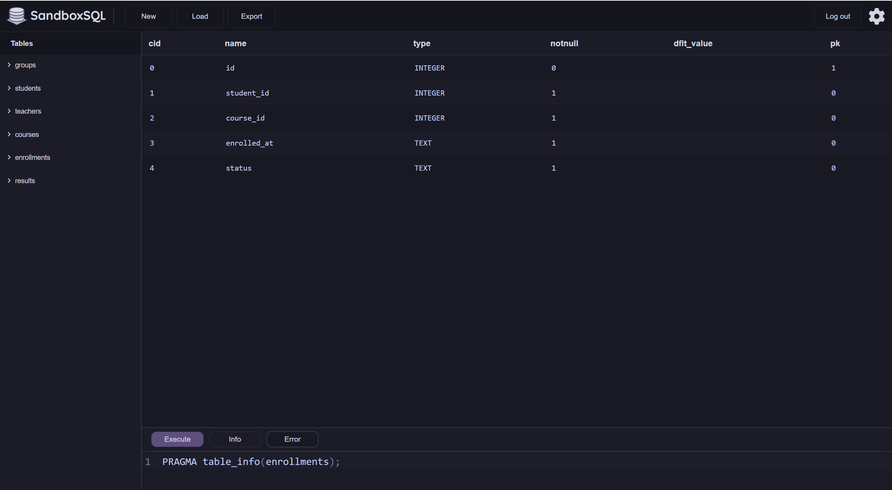

**Пояснение:** таблица `enrollments` содержит идентификатор записи, идентификаторы студента и курса, дату записи и статус. Поля `student_id` и `course_id` связывают её с таблицами `students` и `courses`.

### Первичная проверка количества записей

```sql
SELECT 'groups' AS table_name, COUNT(*) AS total FROM groups
UNION ALL
SELECT 'students', COUNT(*) FROM students
UNION ALL
SELECT 'teachers', COUNT(*) FROM teachers
UNION ALL
SELECT 'courses', COUNT(*) FROM courses
UNION ALL
SELECT 'enrollments', COUNT(*) FROM enrollments
UNION ALL
SELECT 'results', COUNT(*) FROM results;
```

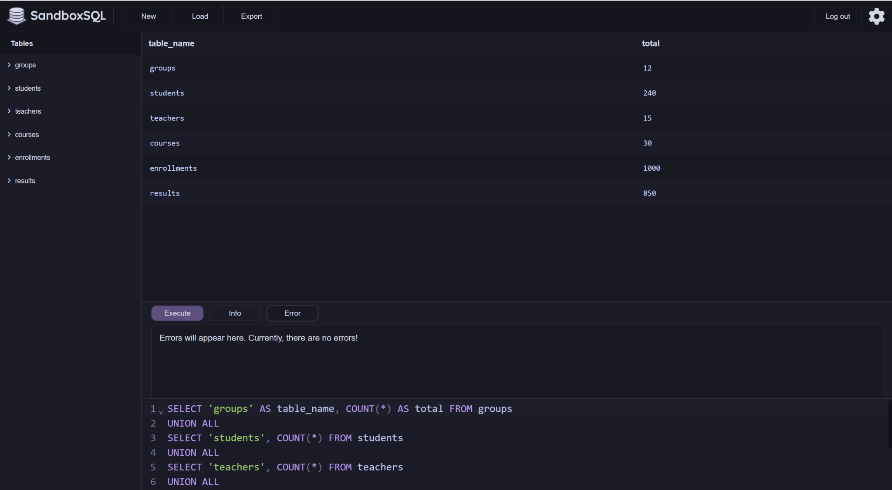

**Результат:** контрольные значения совпали с составом учебной базы: 12 групп, 240 студентов, 15 преподавателей, 30 курсов, 1000 записей на курсы и 850 итоговых оценок.

## 2. Аналитические вопросы

1. Какие курсы имеют продолжительность не менее 60 часов? → `courses`; отбираются курсы по значению `hours`.
2. Какие студенты поступили в 2025 году? → `students`; отбираются записи по `admission_year`.
3. Сколько всего записей на курсы хранится в базе и как они распределены по статусам? → `enrollments`; рассчитывается общее количество и количество записей по каждому `status`.
4. Каковы минимальная, максимальная, средняя и суммарная продолжительность курсов? → `courses`; рассчитываются `MIN`, `MAX`, `AVG` и `SUM` для поля `hours`.
5. Какие курсы закреплены за преподавателями? → `teachers`, `courses`; таблицы соединяются по `courses.teacher_id = teachers.id`.
6. Есть ли некорректные оценки или результаты, не связанные с существующими записями на курсы? → `results`, `enrollments`; проверяются диапазон оценок и наличие соответствующей записи.
7. В каких учебных группах выше доля оценок от 90 баллов включительно? → `groups`, `students`, `enrollments`, `results`; рассчитывается доля высоких оценок от общего количества итоговых оценок каждой группы.

## 3. Фильтрация и сортировка

### 3.1. Курсы продолжительностью не менее 60 часов

**Аналитический вопрос:** какие курсы имеют продолжительность не менее 60 часов?

```sql
SELECT id, course_name, hours
FROM courses
WHERE hours >= 60
ORDER BY hours DESC, course_name ASC;
```

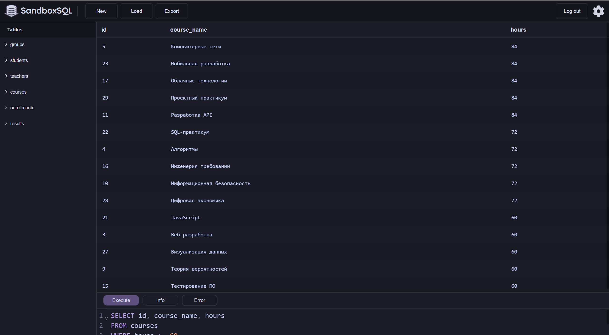

**Результат:** запрос вернул 15 курсов. Наибольшая продолжительность среди отобранных курсов составляет 84 часа, наименьшая — 60 часов.

| ID | Курс | Часы |
|---:|---|---:|
| 5 | Компьютерные сети | 84 |
| 23 | Мобильная разработка | 84 |
| 17 | Облачные технологии | 84 |
| 29 | Проектный практикум | 84 |
| 11 | Разработка API | 84 |
| 22 | SQL-практикум | 72 |
| 4 | Алгоритмы | 72 |
| 16 | Инженерия требований | 72 |
| 10 | Информационная безопасность | 72 |
| 28 | Цифровая экономика | 72 |
| 21 | JavaScript | 60 |
| 3 | Веб-разработка | 60 |
| 27 | Визуализация данных | 60 |
| 9 | Теория вероятностей | 60 |
| 15 | Тестирование ПО | 60 |

**Пояснение:** `WHERE hours >= 60` оставляет курсы продолжительностью от 60 часов. `ORDER BY hours DESC` сортирует их по убыванию часов, а `course_name ASC` задаёт дополнительную сортировку по названию.

### 3.2. Студенты, поступившие в 2025 году

**Аналитический вопрос:** какие первые десять студентов, поступивших в 2025 году, расположены по алфавиту?

```sql
SELECT id, full_name, admission_year
FROM students
WHERE admission_year = 2025
ORDER BY full_name ASC
LIMIT 10;
```

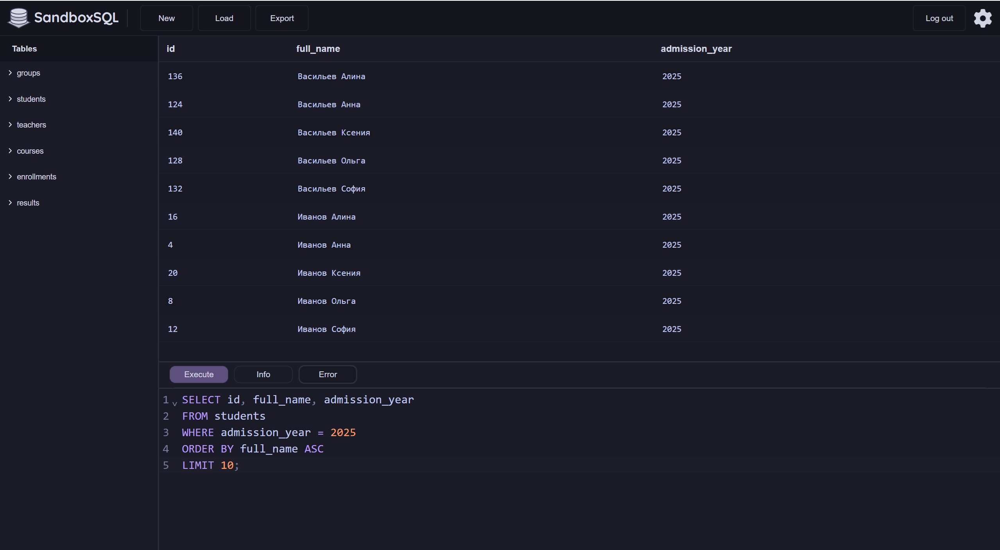

**Результат:** выведены первые 10 студентов 2025 года поступления, отсортированные по полю `full_name`.

| ID | ФИО | Год поступления |
|---:|---|---:|
| 136 | Васильев Алина | 2025 |
| 124 | Васильев Анна | 2025 |
| 140 | Васильев Ксения | 2025 |
| 128 | Васильев Ольга | 2025 |
| 132 | Васильев София | 2025 |
| 16 | Иванов Алина | 2025 |
| 4 | Иванов Анна | 2025 |
| 20 | Иванов Ксения | 2025 |
| 8 | Иванов Ольга | 2025 |
| 12 | Иванов София | 2025 |

**Пояснение:** условие `WHERE` отбирает студентов по году поступления, `ORDER BY` сортирует ФИО по возрастанию, а `LIMIT 10` ограничивает результат десятью строками.

## 4. Агрегирование и группировка

### 4.1. Общее количество записей на курсы

**Аналитический вопрос:** сколько всего записей на курсы содержится в базе?

```sql
SELECT COUNT(*) AS total_enrollments
FROM enrollments;
```

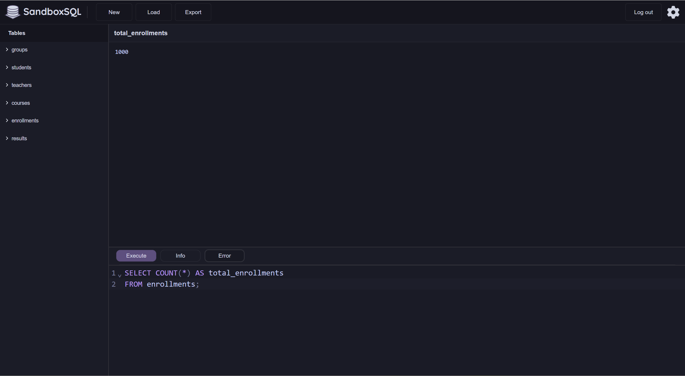

**Результат:** в таблице `enrollments` содержится 1000 записей.

**Пояснение:** `COUNT(*)` подсчитывает все строки таблицы, независимо от значения отдельных полей.

### 4.2. Статистика продолжительности курсов

**Аналитический вопрос:** каковы минимальная, максимальная, средняя и суммарная продолжительность курсов?

```sql
SELECT
    MIN(hours) AS min_hours,
    MAX(hours) AS max_hours,
    AVG(hours) AS avg_hours,
    SUM(hours) AS sum_hours
FROM courses;
```

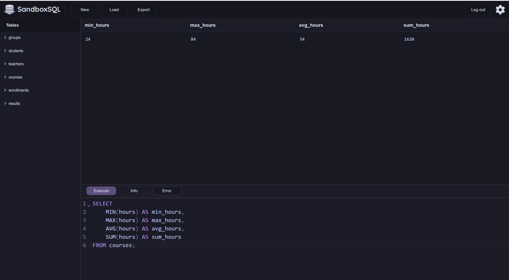

**Результат:**

| Показатель | Значение |
|---|---:|
| Минимальная продолжительность | 24 часа |
| Максимальная продолжительность | 84 часа |
| Средняя продолжительность | 54 часа |
| Суммарная продолжительность | 1620 часов |

**Пояснение:** агрегатные функции позволяют получить общие характеристики числового поля `hours` по всем 30 курсам.

### 4.3. Количество записей по статусам

**Аналитический вопрос:** как распределяются записи на курсы по значениям статуса?

```sql
SELECT
    status,
    COUNT(*) AS total
FROM enrollments
GROUP BY status
ORDER BY total DESC;
```

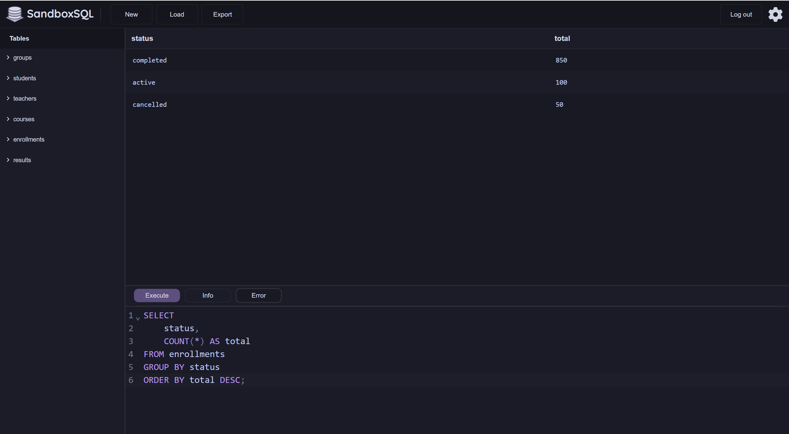

**Результат:**

| Статус | Количество |
|---|---:|
| `completed` | 850 |
| `active` | 100 |
| `cancelled` | 50 |
| **Всего** | **1000** |

**Пояснение:** `GROUP BY status` формирует отдельную группу для каждого статуса, а `COUNT(*)` подсчитывает число записей в каждой группе. Сумма по статусам равна общему количеству записей — 1000.

### 4.4. Фильтрация групп с помощью HAVING

**Аналитический вопрос:** какие статусы встречаются более 100 раз?

```sql
SELECT
    status,
    COUNT(*) AS total
FROM enrollments
GROUP BY status
HAVING COUNT(*) > 100
ORDER BY total DESC;
```

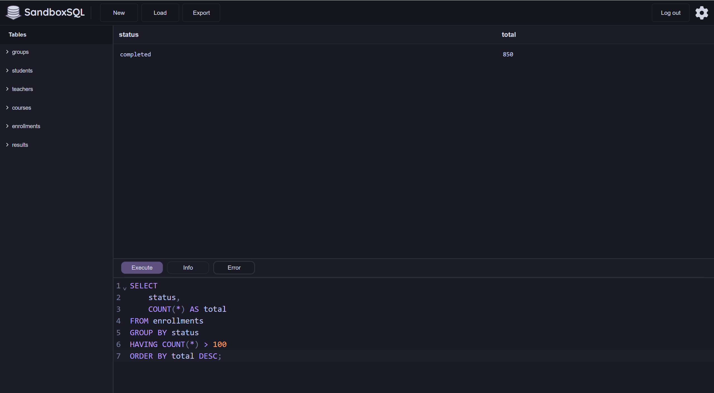

**Результат:** условию соответствует только статус `completed` — 850 записей.

**Пояснение:** `WHERE` фильтрует отдельные строки до группировки, а `HAVING` фильтрует уже сформированные группы по агрегатным значениям. В данном запросе `HAVING COUNT(*) > 100` оставляет только статусы, количество записей которых превышает 100.

## 5. Анализ связанных таблиц

### 5.1. Студенты и учебные группы (INNER JOIN)

**Аналитический вопрос:** к каким учебным группам относятся первые десять студентов?

```sql
SELECT
    s.id,
    s.full_name,
    g.group_name
FROM students AS s
INNER JOIN groups AS g
    ON g.id = s.group_id
ORDER BY s.id
LIMIT 10;
```

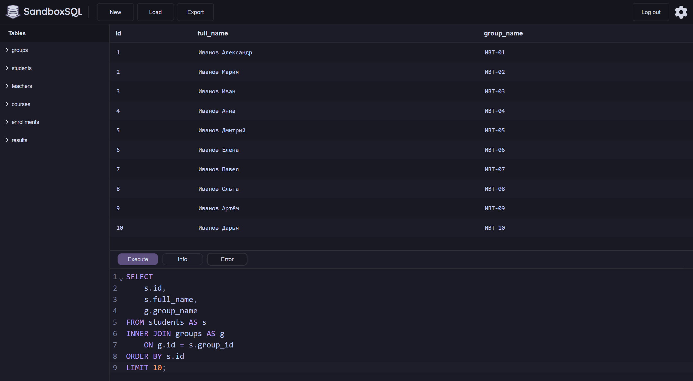

**Результат:** получено 10 строк. В каждой строке показаны идентификатор и ФИО студента, а также название его учебной группы.

**Пояснение:** `INNER JOIN` оставляет только те строки, для которых найдено соответствие между `students.group_id` и `groups.id`.

### 5.2. Курсы и преподаватели (INNER JOIN)

**Аналитический вопрос:** какие преподаватели назначены на первые десять курсов?

```sql
SELECT
    c.id,
    c.course_name,
    t.full_name AS teacher_name
FROM courses AS c
INNER JOIN teachers AS t
    ON t.id = c.teacher_id
ORDER BY c.id
LIMIT 10;
```

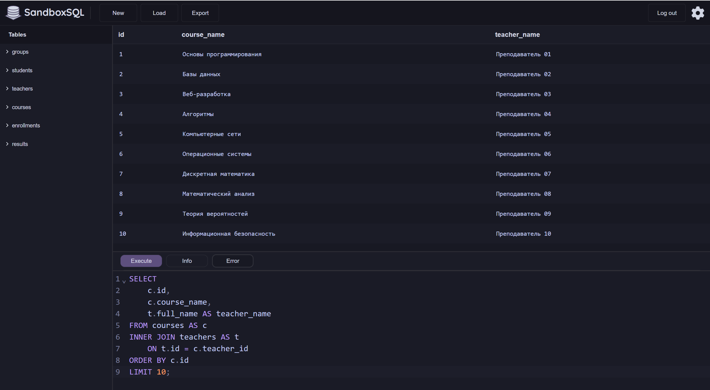

**Результат:** получено 10 строк с названиями курсов и ФИО назначенных преподавателей.

**Пояснение:** соединение выполняется по внешнему ключу `courses.teacher_id`. `INNER JOIN` выводит курсы, для которых найден соответствующий преподаватель.

### 5.3. Все преподаватели и закреплённые курсы (LEFT JOIN)

**Аналитический вопрос:** какие курсы закреплены за каждым преподавателем?

```sql
SELECT
    t.id AS teacher_id,
    t.full_name AS teacher_name,
    c.id AS course_id,
    c.course_name
FROM teachers AS t
LEFT JOIN courses AS c
    ON c.teacher_id = t.id
ORDER BY t.id, c.id;
```

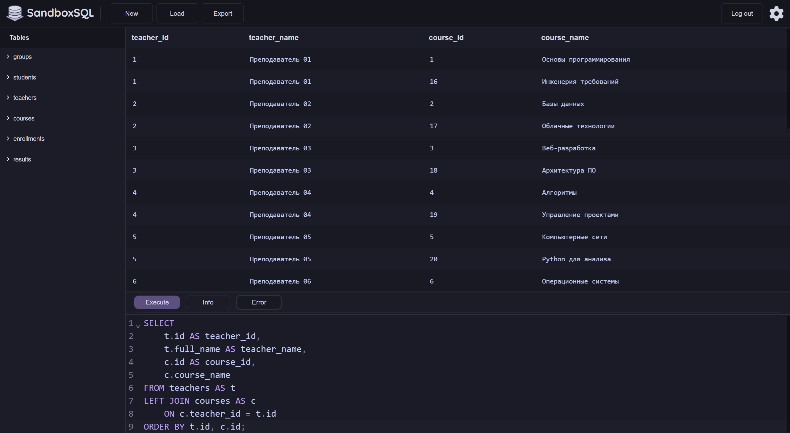

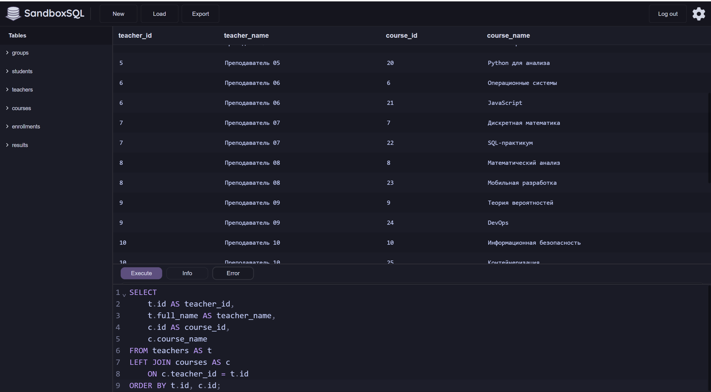

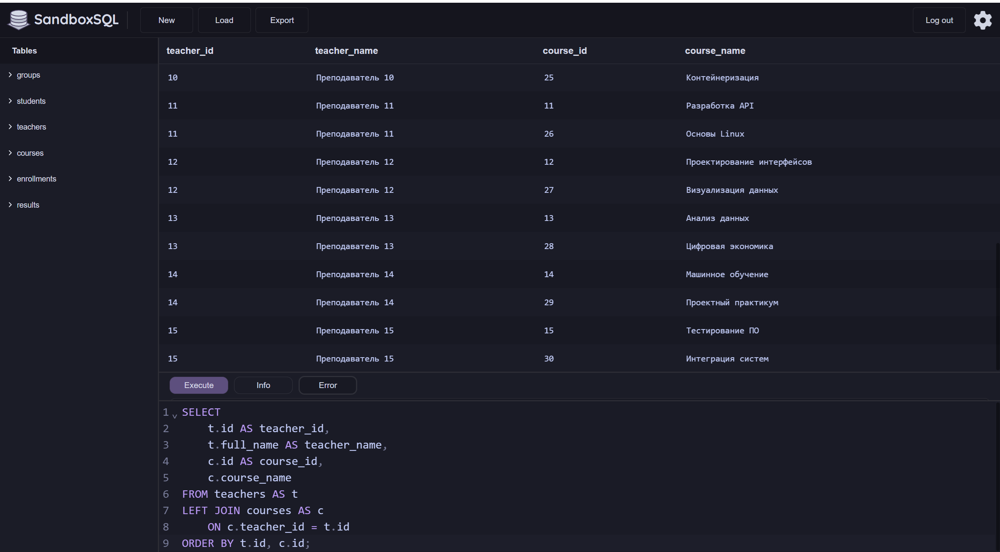

**Результат:** запрос вернул 30 строк. В базе 15 преподавателей, каждый из которых связан с двумя курсами.

**Пояснение:** `LEFT JOIN` сохраняет все строки левой таблицы `teachers`. Если у преподавателя нет соответствующего курса, поля `courses` в результате имели бы значение `NULL`. Число строк может быть больше числа преподавателей, поскольку один преподаватель может вести несколько курсов. В данном наборе данных каждому преподавателю назначено по два курса.

**Разница между типами соединения:** `INNER JOIN` возвращает только совпавшие записи из обеих таблиц, а `LEFT JOIN` сохраняет все записи левой таблицы и добавляет совпадающие данные из правой таблицы.

## 6. Проверка корректности

### 6.1. Проверка диапазона оценок

**Что проверялось:** наличие оценок меньше 0, больше 100 или равных `NULL`.

```sql
SELECT COUNT(*) AS invalid_scores
FROM results
WHERE score < 0
   OR score > 100
   OR score IS NULL;
```

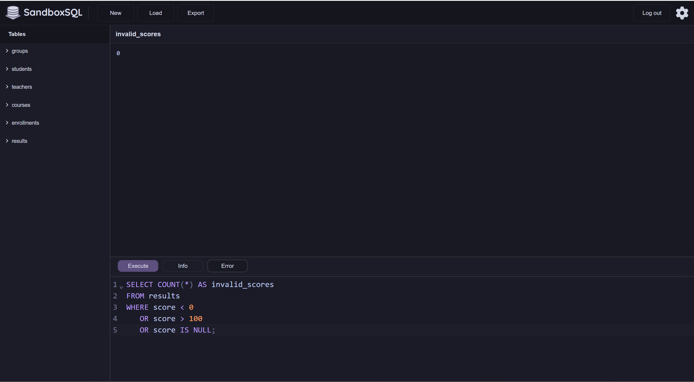

**Результат:** `invalid_scores = 0`. Записей с оценками вне диапазона от 0 до 100 или с отсутствующим значением оценки не обнаружено.

### 6.2. Проверка связей результатов с записями на курсы

**Что проверялось:** наличие результатов, для которых отсутствует соответствующая запись в `enrollments`.

```sql
SELECT COUNT(*) AS orphan_results
FROM results AS r
LEFT JOIN enrollments AS e
    ON e.id = r.enrollment_id
WHERE e.id IS NULL;
```

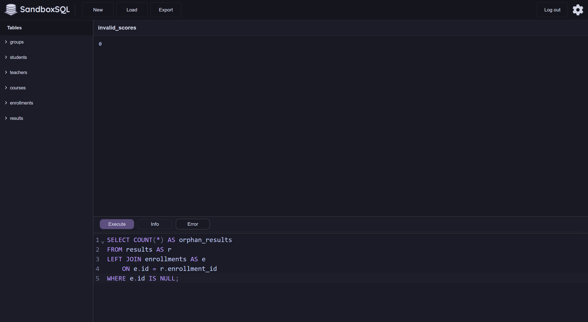

**Результат:** `orphan_results = 0`. Все записи в `results` имеют соответствующую запись в `enrollments`.

### Сводная таблица проверок

| Проверка | Ожидаемое значение | Полученное значение | Итог |
|---|---:|---:|---|
| Количество оценок вне диапазона 0–100 или `NULL` | 0 | 0 | Пройдена |
| Количество результатов без соответствующей записи | 0 | 0 | Пройдена |
| Количество записей на курсы | 1000 | 1000 | Пройдена |
| Сумма записей по статусам | 1000 | 1000 | Пройдена |

**Вывод:** по выполненным проверкам некорректных оценок и нарушенных связей между `results` и `enrollments` не обнаружено. Проверки подтверждают только перечисленные условия и не исключают всех возможных ошибок данных.

## 7. Аналитические выводы

### 7.1. Индивидуальный вопрос — вариант 9

**Вопрос:** в каких учебных группах выше доля оценок от 90 баллов включительно? Сравните доли, а не только количества.

**Используемые таблицы:** `groups`, `students`, `enrollments`, `results`.

Для ответа необходимо связать группы со студентами, студентов — с записями на курсы, а записи — с итоговыми результатами. Для каждой группы рассчитываются общее количество оценок, количество оценок не ниже 90 баллов и доля таких оценок в процентах.

### 7.2. Основной аналитический запрос

```sql
SELECT
    g.id,
    g.group_name,
    COUNT(r.id) AS total_scores,
    SUM(CASE WHEN r.score >= 90 THEN 1 ELSE 0 END) AS scores_90_plus,
    ROUND(
        100.0 * SUM(CASE WHEN r.score >= 90 THEN 1 ELSE 0 END)
        / NULLIF(COUNT(r.id), 0),
        2
    ) AS percent_90_plus
FROM groups AS g
LEFT JOIN students AS s
    ON s.group_id = g.id
LEFT JOIN enrollments AS e
    ON e.student_id = s.id
LEFT JOIN results AS r
    ON r.enrollment_id = e.id
GROUP BY g.id, g.group_name
ORDER BY percent_90_plus DESC, total_scores DESC;
```

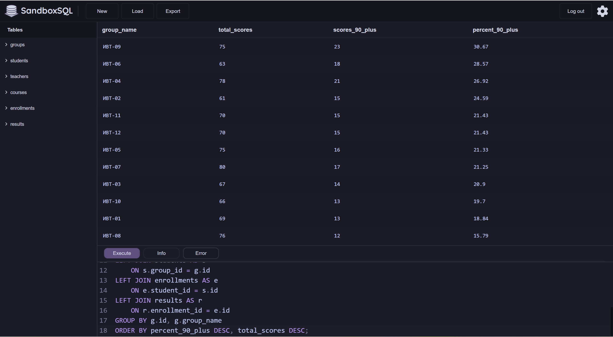

**Результат:**

| Учебная группа | Всего оценок | Оценок 90+ | Доля 90+, % |
|---|---:|---:|---:|
| ИВТ-09 | 75 | 23 | 30,67 |
| ИВТ-06 | 63 | 18 | 28,57 |
| ИВТ-04 | 78 | 21 | 26,92 |
| ИВТ-02 | 61 | 15 | 24,59 |
| ИВТ-11 | 70 | 15 | 21,43 |
| ИВТ-12 | 70 | 15 | 21,43 |
| ИВТ-05 | 75 | 16 | 21,33 |
| ИВТ-07 | 80 | 17 | 21,25 |
| ИВТ-03 | 67 | 14 | 20,90 |
| ИВТ-10 | 66 | 13 | 19,70 |
| ИВТ-01 | 69 | 13 | 18,84 |
| ИВТ-08 | 76 | 12 | 15,79 |

**Пояснение:** доля рассчитывается как отношение количества оценок от 90 баллов включительно к общему количеству итоговых оценок группы, умноженное на 100%. `NULLIF` защищает деление от нулевого знаменателя. `LEFT JOIN` позволяет сохранить в выборке все учебные группы, в том числе группы без итоговых оценок.

### 7.3. Проверочный запрос

Для проверки расчётов выполнен повторный подсчёт с использованием `INNER JOIN`. В этом запросе рассматриваются группы, для которых существуют связанные студенты, записи на курсы и результаты.

```sql
SELECT
    g.group_name,
    COUNT(r.id) AS total_scores,
    SUM(CASE WHEN r.score >= 90 THEN 1 ELSE 0 END) AS scores_90_plus,
    ROUND(
        100.0 * SUM(CASE WHEN r.score >= 90 THEN 1 ELSE 0 END)
        / COUNT(r.id),
        2
    ) AS percent_90_plus
FROM groups AS g
INNER JOIN students AS s
    ON s.group_id = g.id
INNER JOIN enrollments AS e
    ON e.student_id = s.id
INNER JOIN results AS r
    ON r.enrollment_id = e.id
GROUP BY g.id, g.group_name
ORDER BY percent_90_plus DESC;
```

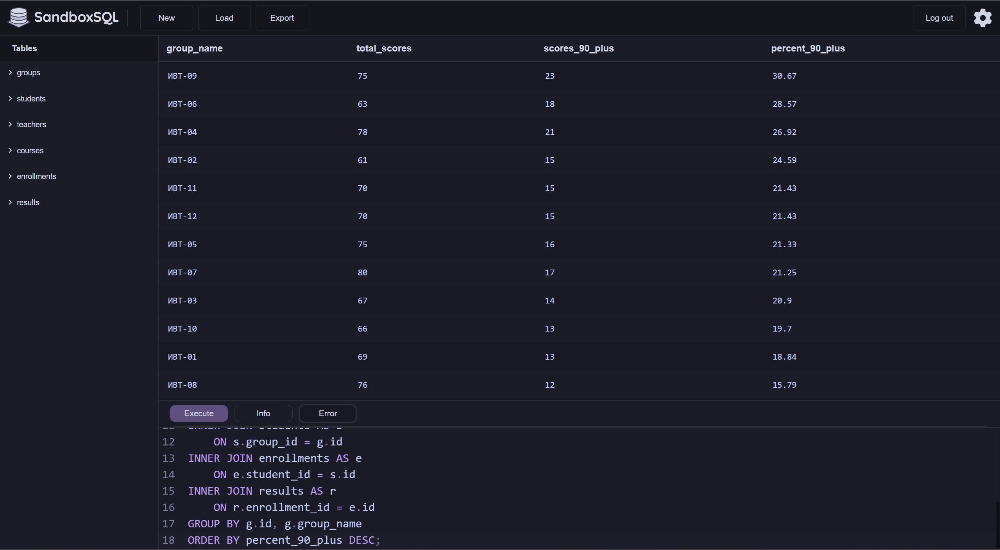

**Результат:** значения по всем 12 группам совпали с основным запросом: совпадают общее количество оценок, количество оценок от 90 баллов и рассчитанные проценты.

### 7.4. Ответ на вопрос варианта и выводы

**Ответ:** наибольшая доля оценок от 90 баллов включительно обнаружена в группе **ИВТ-09**. В этой группе 23 оценки из 75 итоговых соответствуют условию, что составляет **30,67%**.

**Вывод 1.** Группа ИВТ-09 занимает первое место по доле оценок от 90 баллов — 30,67%. Следом идут ИВТ-06 с 28,57% и ИВТ-04 с 26,92%.

**Вывод 2.** Сравнение только абсолютного количества высоких оценок может привести к неверному ранжированию. Например, в ИВТ-07 получено 17 оценок от 90 баллов, но их доля составляет 21,25%; в ИВТ-06 таких оценок 18, а доля выше — 28,57%.

**Вывод 3.** Наименьшая доля высоких оценок наблюдается в группе ИВТ-08 — 15,79% (12 из 76). Разница между максимальной и минимальной долями составляет 14,88 процентного пункта.

**Ограничения анализа:** сравнение выполнено по имеющимся итоговым оценкам, а не по всем студентам или всем записям на курсы. Поэтому результат характеризует распределение оценок в представленном наборе данных. На долю могут влиять количество оценок в группе и состав курсов, по которым получены результаты. Сам по себе высокий процент не доказывает причин различий в успеваемости.

## Итог

В ходе работы изучена структура учебной базы из шести связанных таблиц, выполнены запросы с фильтрацией и сортировкой, агрегатными функциями, группировкой и соединением таблиц. Проведены проверки диапазона оценок и связей между результатами и записями на курсы.

В индивидуальном исследовании по варианту 9 рассчитана доля оценок от 90 баллов включительно для каждой учебной группы. Наибольший показатель получен у группы ИВТ-09 — 30,67% (23 из 75 оценок). Результаты основного и проверочного запросов совпали.
