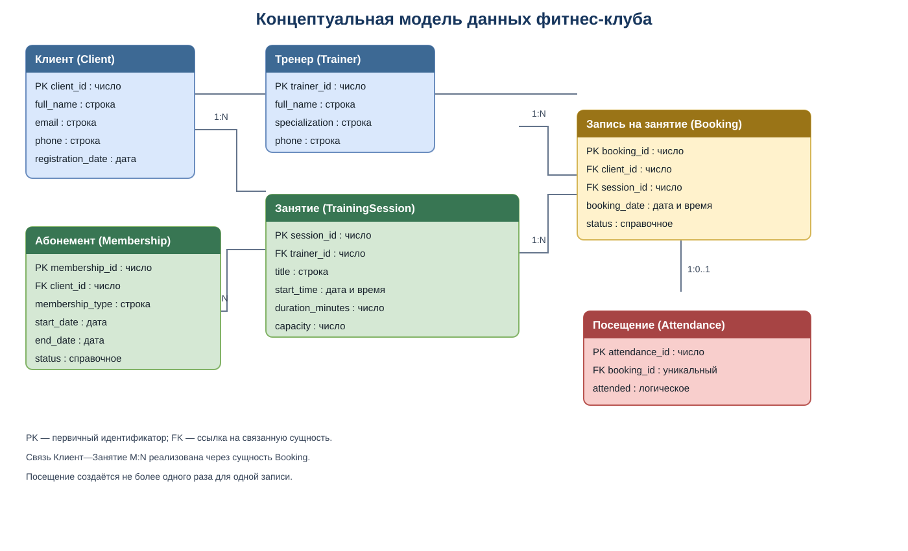

# Лабораторная работа № 3

## Анализ и моделирование данных предметной области

**Модуль:** Данные и технологии хранения информации  
**Вариант:** 9  
**Предметная область:** Фитнес-клуб

## 1. Описание предметной области

**Название цифрового сервиса:** информационная система фитнес-клуба.

**Назначение:** система предназначена для ведения информации о клиентах и тренерах, учёта абонементов, планирования групповых тренировок, записи клиентов на занятия и фиксации посещений.

**Основные пользователи:**
- **Клиент** — просматривает доступные занятия, записывается на тренировки и посещает их.
- **Тренер** — проводит занятия и предоставляет сведения о своей специализации и расписании.
- **Администратор клуба** — регистрирует клиентов, оформляет абонементы, управляет расписанием и проверяет записи и посещения.

**Основные процессы:**
- регистрация и ведение данных клиентов;
- оформление и учёт абонементов;
- ведение списка тренеров;
- создание расписания тренировок;
- запись клиентов на занятия и отмена записи;
- фиксация факта посещения занятия.

**Основные задачи информационной системы:**
- хранить актуальные сведения о клиентах, тренерах, абонементах и занятиях;
- показывать расписание и доступность занятий;
- предотвращать превышение установленной вместимости занятия;
- хранить историю записей и посещений;
- обеспечивать быстрый поиск и обновление информации.

В рамках модели рассматриваются данные, необходимые для перечисленных процессов. Реализация базы данных и программного приложения в лабораторной работе не выполняется.

## 2. Объекты данных

### 2.1. Клиент (Client)

**Назначение:** человек, который пользуется услугами фитнес-клуба.

**Хранимая информация:** идентификатор клиента, ФИО, адрес электронной почты, телефон и дата регистрации. Эти данные позволяют идентифицировать клиента и связывать его с абонементами и записями на занятия.

### 2.2. Абонемент (Membership)

**Назначение:** запись об абонементе, оформленном клиенту.

**Хранимая информация:** идентификатор абонемента, идентификатор владельца, тип абонемента, дата начала и окончания действия, статус. Абонемент связывает клиента с правом посещать клуб в определённый период.

### 2.3. Тренер (Trainer)

**Назначение:** сотрудник клуба, который проводит тренировки.

**Хранимая информация:** идентификатор тренера, ФИО, специализация и контактный телефон.

### 2.4. Занятие (TrainingSession)

**Назначение:** запланированная тренировка, на которую могут записываться клиенты.

**Хранимая информация:** идентификатор занятия, идентификатор тренера, название, дата и время начала, продолжительность и максимальное количество участников.

### 2.5. Запись на занятие (Booking)

**Назначение:** регистрация намерения клиента посетить конкретное занятие.

**Хранимая информация:** идентификатор записи, идентификатор клиента, идентификатор занятия, дата создания записи и статус. Эта сущность позволяет связать клиентов и занятия отношением «многие ко многим».

### 2.6. Посещение (Attendance)

**Назначение:** фиксация результата посещения по конкретной записи.

**Хранимая информация:** идентификатор посещения, идентификатор записи и признак фактического посещения. Для одной записи создаётся не более одной записи о посещении; до проведения занятия отметка может отсутствовать.

## 3. Атрибуты объектов

Типы данных указаны на концептуальном уровне: строка, число, дата, дата и время, логическое значение. Они не привязаны к конкретной СУБД.

### 3.1. Клиент (Client)

| Атрибут | Тип данных | Описание |
|---|---|---|
| `client_id` | Число | Уникальный идентификатор клиента |
| `full_name` | Строка | Фамилия, имя и отчество клиента |
| `email` | Строка | Адрес электронной почты |
| `phone` | Строка | Контактный телефон |
| `registration_date` | Дата | Дата регистрации в системе |

### 3.2. Абонемент (Membership)

| Атрибут | Тип данных | Описание |
|---|---|---|
| `membership_id` | Число | Уникальный идентификатор абонемента |
| `client_id` | Число | Идентификатор клиента-владельца |
| `membership_type` | Строка / справочное значение | Вид абонемента |
| `start_date` | Дата | Начало действия |
| `end_date` | Дата | Окончание действия |
| `status` | Строка / справочное значение | Состояние абонемента |

### 3.3. Тренер (Trainer)

| Атрибут | Тип данных | Описание |
|---|---|---|
| `trainer_id` | Число | Уникальный идентификатор тренера |
| `full_name` | Строка | ФИО тренера |
| `specialization` | Строка | Направление подготовки или специализация |
| `phone` | Строка | Контактный телефон |

### 3.4. Занятие (TrainingSession)

| Атрибут | Тип данных | Описание |
|---|---|---|
| `session_id` | Число | Уникальный идентификатор занятия |
| `trainer_id` | Число | Тренер, ведущий занятие |
| `title` | Строка | Название или вид тренировки |
| `start_time` | Дата и время | Дата и время начала занятия |
| `duration_minutes` | Число | Продолжительность в минутах |
| `capacity` | Число | Максимальное количество участников |

### 3.5. Запись на занятие (Booking)

| Атрибут | Тип данных | Описание |
|---|---|---|
| `booking_id` | Число | Уникальный идентификатор записи |
| `client_id` | Число | Клиент, записавшийся на занятие |
| `session_id` | Число | Занятие, на которое оформлена запись |
| `booking_date` | Дата и время | Дата и время создания записи |
| `status` | Строка / справочное значение | Состояние записи |

### 3.6. Посещение (Attendance)

| Атрибут | Тип данных | Описание |
|---|---|---|
| `attendance_id` | Число | Уникальный идентификатор отметки |
| `booking_id` | Число | Запись, к которой относится посещение; для каждой записи допускается не более одной отметки |
| `attended` | Логическое значение | Признак фактического посещения |

## 4. Классификация данных

### 4.1. Клиент (Client)

| Атрибут | Категория данных | Описание |
|---|---|---|
| `client_id` | Числовые | Идентификатор клиента |
| `full_name` | Текстовые | ФИО клиента |
| `email` | Текстовые | Электронная почта |
| `phone` | Текстовые | Телефон хранится как строка, так как может включать `+` и ведущие нули |
| `registration_date` | Даты | Дата регистрации |

### 4.2. Абонемент (Membership)

| Атрибут | Категория данных | Описание |
|---|---|---|
| `membership_id`, `client_id` | Числовые | Идентификаторы абонемента и клиента |
| `membership_type` | Справочные | Тип выбирается из утверждённого набора видов абонементов |
| `start_date`, `end_date` | Даты | Период действия |
| `status` | Справочные | Например, активен, приостановлен, истёк |

### 4.3. Тренер (Trainer)

| Атрибут | Категория данных | Описание |
|---|---|---|
| `trainer_id` | Числовые | Идентификатор тренера |
| `full_name`, `phone` | Текстовые | ФИО и контактный телефон |
| `specialization` | Текстовые / справочные | Специализация тренера; при необходимости выбирается из списка направлений |

### 4.4. Занятие (TrainingSession)

| Атрибут | Категория данных | Описание |
|---|---|---|
| `session_id`, `trainer_id` | Числовые | Идентификаторы занятия и тренера |
| `title` | Текстовые / справочные | Название или вид тренировки |
| `start_time` | Дата и время | Планируемое начало |
| `duration_minutes`, `capacity` | Числовые | Длительность и допустимое число участников |

### 4.5. Запись на занятие (Booking)

| Атрибут | Категория данных | Описание |
|---|---|---|
| `booking_id`, `client_id`, `session_id` | Числовые | Идентификаторы записи, клиента и занятия |
| `booking_date` | Дата и время | Момент создания записи |
| `status` | Справочные | Например, активна, отменена, завершена |

### 4.6. Посещение (Attendance)

| Атрибут | Категория данных | Описание |
|---|---|---|
| `attendance_id`, `booking_id` | Числовые | Идентификаторы отметки и записи |
| `attended` | Логические | Значение «да/нет» — посетил ли клиент занятие |

### 4.7. Вычисляемые данные

- **Количество свободных мест** — вместимость занятия минус число действующих записей на него. Отменённые записи не учитываются.
- **Продолжительность занятия в часах** — может быть получена из `duration_minutes`.
- **Признак действующего абонемента** — может определяться по датам начала и окончания и текущей дате; отдельное хранение такого вычисляемого признака может приводить к несогласованности.

Вычисляемые значения не обязательно хранить как самостоятельные атрибуты: их можно получать при обработке данных.

## 5. Связи между объектами

### Связь 1. Клиент — Абонемент

- **Тип:** один ко многим (1:N).
- **Описание:** один клиент может оформить несколько абонементов в разные периоды; каждый абонемент относится к одному клиенту.
- **Обоснование:** история абонементов позволяет учитывать повторные покупки и продления.

### Связь 2. Тренер — Занятие

- **Тип:** один ко многим (1:N).
- **Описание:** один тренер может проводить много занятий, каждое занятие в данной модели назначено одному тренеру.

### Связь 3. Клиент — Запись на занятие

- **Тип:** один ко многим (1:N).
- **Описание:** клиент может создать много записей, каждая запись относится к одному клиенту.

### Связь 4. Занятие — Запись на занятие

- **Тип:** один ко многим (1:N).
- **Описание:** на одно занятие могут записаться многие клиенты; каждая запись относится к одному занятию.
- **Дополнение:** в целом связь между клиентами и занятиями является многие ко многим (M:N) и представлена через сущность `Booking`.

### Связь 5. Запись на занятие — Посещение

- **Тип:** один к одному (1:1), при этом отметка посещения может отсутствовать до проведения занятия.
- **Описание:** одна запись может иметь не более одной отметки посещения, а каждая отметка относится к одной записи.

### Ограничения и правила модели

- Идентификаторы объектов уникальны.
- Запись должна ссылаться на существующего клиента и существующее занятие.
- Число действующих записей на занятие не должно превышать его вместимость.
- Дата окончания абонемента не должна быть раньше даты начала.
- Для одного клиента не следует создавать дублирующие действующие записи на одно и то же занятие.
- Статусы абонементов и записей должны выбираться из согласованного набора значений.

## 6. Концептуальная модель данных

На диаграмме представлены сущности информационной системы фитнес-клуба, их основные атрибуты и связи. Идентификаторы `*_id` используются для различения объектов; атрибуты `client_id`, `trainer_id`, `session_id` и `booking_id` связывают зависимые сущности с соответствующими объектами.

Исходный редактируемый файл диаграммы: [fitness_club_er.drawio](../diagrams/fitness_club_er.drawio).

Модель охватывает регистрацию клиентов, учёт абонементов, расписание тренеров, запись на тренировки и фиксацию посещений. Реализация базы данных в рамках данной лабораторной работы не выполняется.

## 7. Оценка качества исходных данных

**1. Достаточно ли объектов выделено?**

Для описания основных процессов фитнес-клуба выделены клиент, абонемент, тренер, занятие, запись и посещение. Этого достаточно для базовой концептуальной модели, охватывающей регистрацию, планирование и учёт посещений.

**2. Отсутствуют ли важные сущности?**

Для расширенной системы можно добавить оплату, филиал, тренировочный зал, оборудование и тарифный план как отдельные сущности. В текущей модели они не выделены, поскольку не являются обязательными для описания процессов, указанных в варианте задания. Тип абонемента пока хранится как справочное значение.

**3. Все ли необходимые атрибуты определены?**

Для базового сценария атрибутов достаточно: есть идентификаторы, контактные данные, даты, статусы, расписание, вместимость и факт посещения. В дальнейшем можно добавить ограничения по сроку действия абонемента, причину отмены записи и место проведения занятия.

**4. Имеются ли дублирующиеся данные?**

ФИО и контакты тренера хранятся в сущности `Trainer`, а сведения о клиенте — в `Client`. В записях и занятиях используются идентификаторы связанных объектов вместо повторения их имён. Это уменьшает дублирование и риск несогласованности данных.

**5. Достаточно ли информации для дальнейшего проектирования информационной системы?**

Информации достаточно для перехода к логическому проектированию базовой системы. Перед реализацией необходимо уточнить бизнес-правила: виды абонементов, порядок продления, условия отмены записи, правила учёта вместимости и допустимые статусы.

**Вывод:**

В ходе анализа предметной области фитнес-клуба определены основные объекты данных, их атрибуты и предполагаемые типы данных, выполнена классификация данных и установлены связи между сущностями. Построенная концептуальная модель отражает основные процессы регистрации клиентов, оформления абонементов, планирования тренировок, записи на занятия и учёта посещений. Модель подходит для дальнейшего проектирования; при расширении требований её можно дополнить сущностями оплаты, залов и тарифов.
